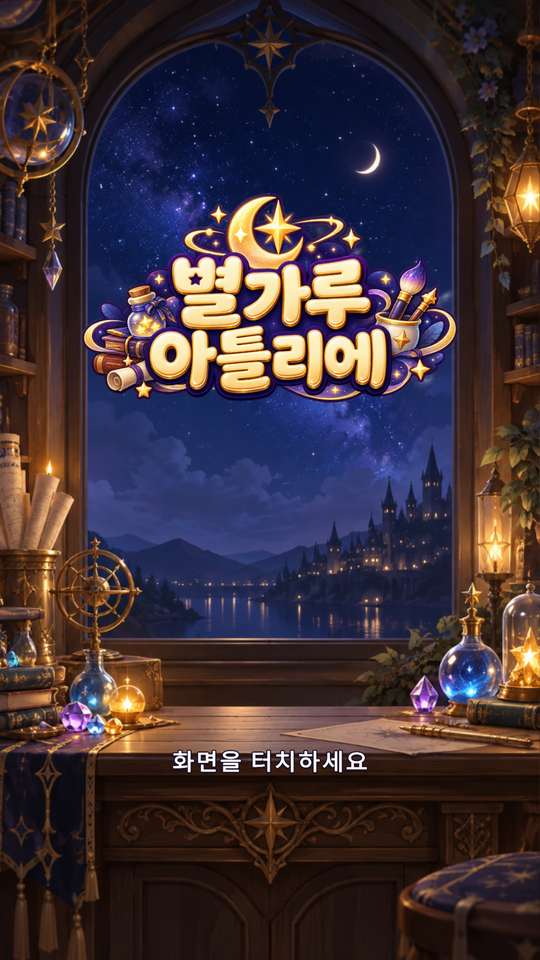
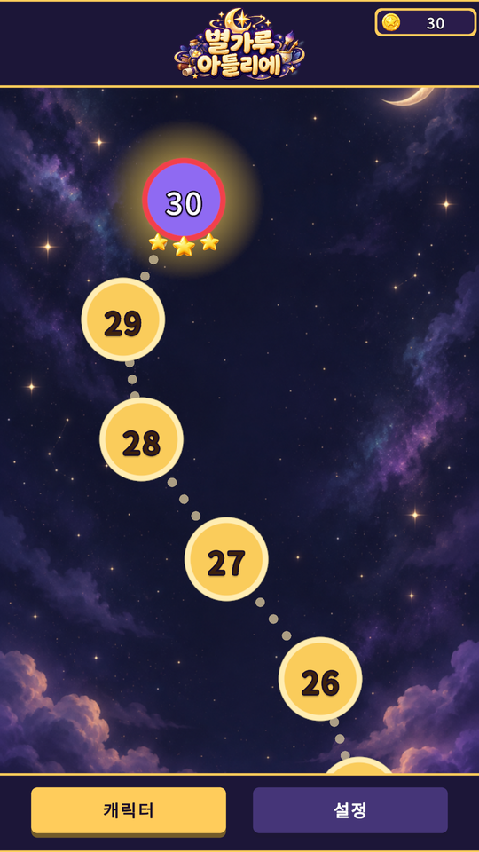
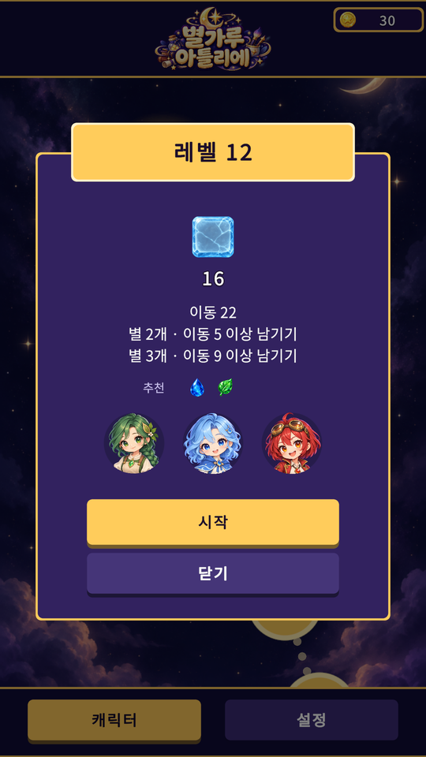
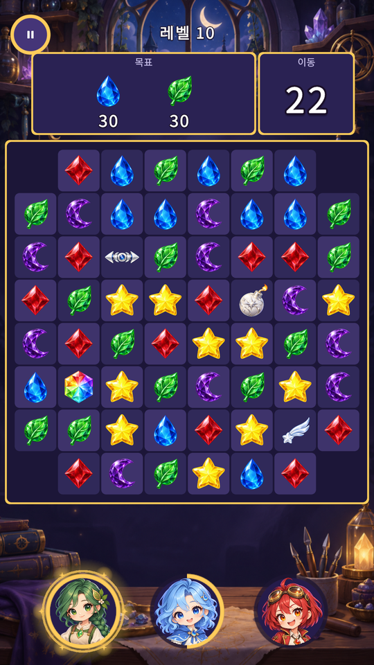
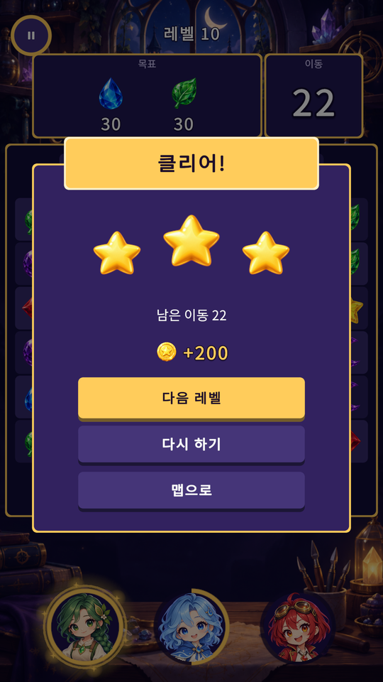
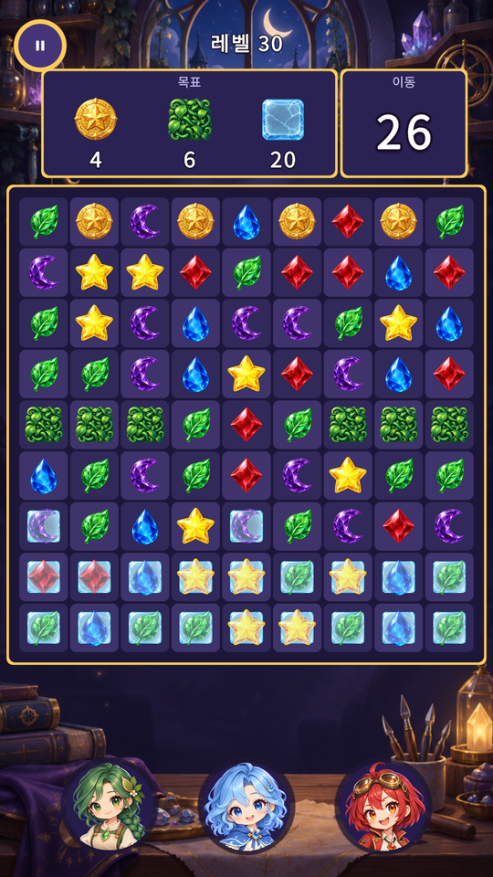
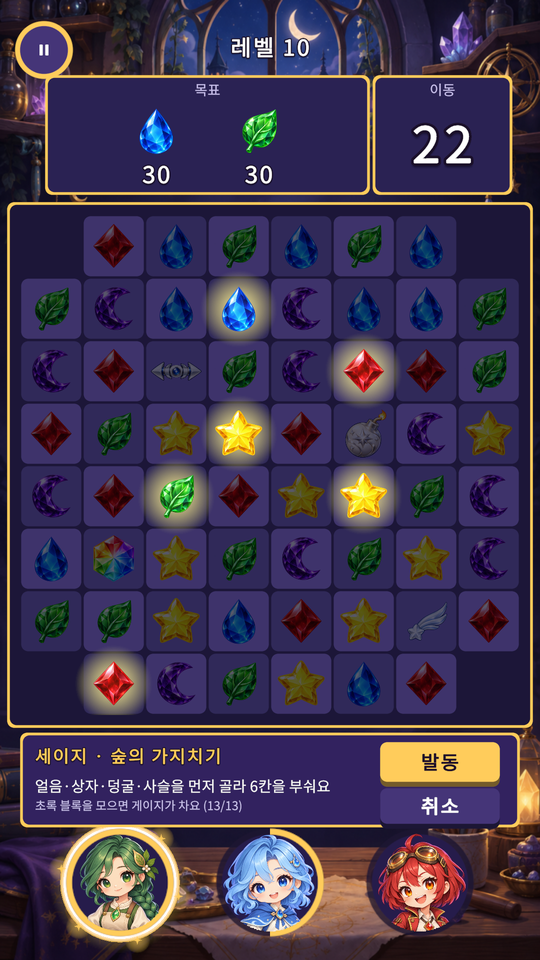
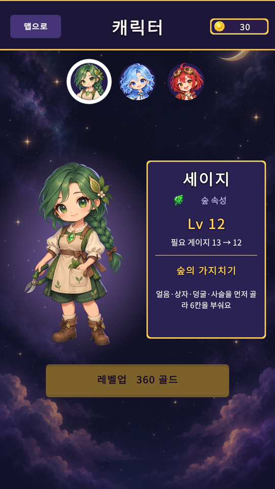
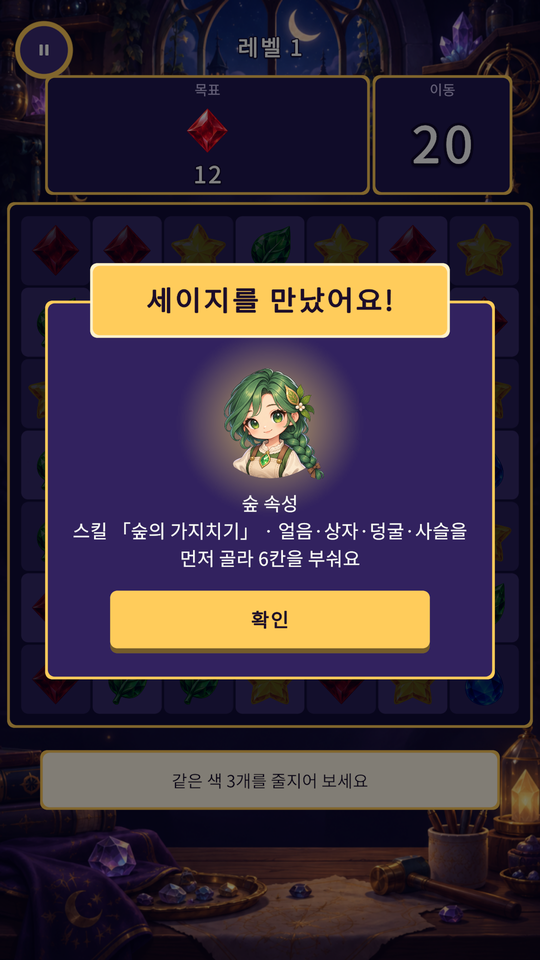
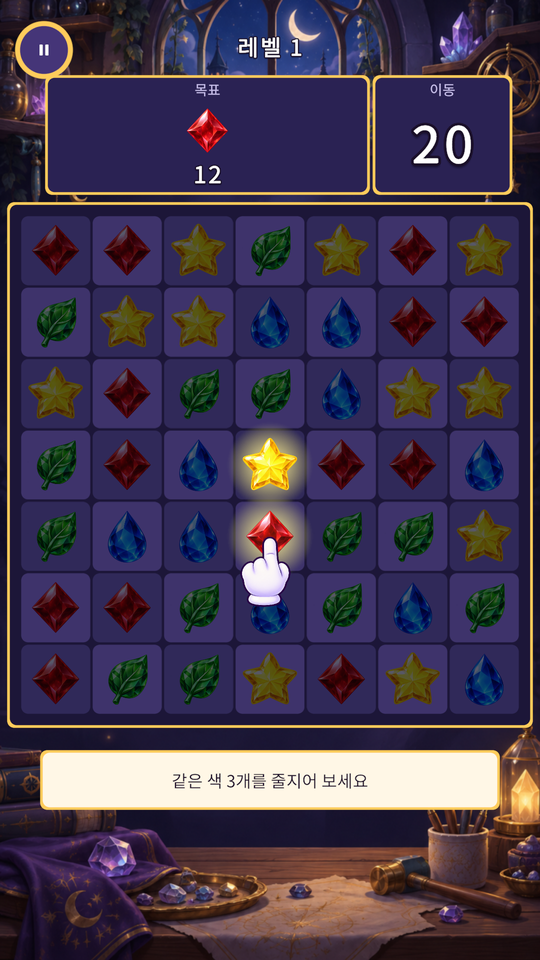

<p align="center">
  
</p>

# 별가루 아틀리에 (Stardust Atelier)

> 블록을 맞춰 게이지를 채우고, 캐릭터 스킬로 판을 뒤집는 Unity 2D 매치3 퍼즐

## 플레이 화면

<p align="center">
  
  
  
  
  
</p>

| 타이틀 | 레벨 맵 | 레벨 진입 | 플레이 | 결과 |
| :---: | :---: | :---: | :---: | :---: |
| 터치해서 시작 | 레벨 1~30과 받은 별 | 목표·별 기준·파티 편성 | 목표, 남은 이동, 파티 | 별과 골드 보상 |

## 프로젝트 정보

| 항목 | 내용 |
| --- | --- |
| 개발 형태 | 개인 프로젝트 |
| 제작 기간 | 2026.10.09 ~ 2026.10.10 |
| 개발 환경 | Unity 6000.3.13f1 (URP 2D, uGUI) |
| 사용 기술 | C#, JSON, Unity Test Framework, Git |
| 콘텐츠 규모 | 레벨 30개, 캐릭터 5명, 아이템 4종, 장애물 5종 |
| 화면 | 세로 1080×1920 |
| 제작 방식 | 기획서를 먼저 쓰고 구현. 그림·소리·효과 제작과 코드 작성에 AI 도구 사용 |

## 게임 소개

같은 색 블록 3개를 맞춰 없애고, 정해진 이동 수 안에 레벨 목표를 채우면 클리어한다. 블록을 모으면 같은 속성 캐릭터의 게이지가 차고, 가득 차면 이동을 쓰지 않고 스킬을 쓸 수 있다. 클리어하면 남긴 이동 수에 따라 별과 골드를 받고, 골드로 캐릭터를 키운다.

```text
블록 매치 → 목표 수집 · 게이지 충전 → 스킬 사용 → 클리어 → 골드로 캐릭터 성장 → 다음 레벨
```

## 핵심 기능

### 1. 아이템과 조합

<p align="center">
  
  
</p>

- 4개 일렬은 로켓, L·T자는 폭탄, 5개 일렬은 프리즘, 2×2는 별똥별
- 아이템은 한 번 눌러서 쓰거나 옆 칸으로 옮겨 그 자리에서 발동
- 아이템 둘을 합치면 조합 효과 (폭탄+폭탄은 5×5, 로켓+폭탄은 세 줄씩 등)
- 별똥별은 가장 많이 남은 목표를 찾아감

### 2. 장애물

- 얼음: 갇힌 블록은 얼음이 다 깨질 때까지 움직이지 않음
- 상자·덩굴: 옆에서 매치해 깨고, 덩굴은 한 턴 건드리지 않으면 번짐
- 사슬: 묶인 블록은 옮길 수 없고 매치에 포함하면 풀림
- 유물: 맨 아래 줄까지 내리면 수집

### 3. 캐릭터와 스킬

<p align="center">
  
  
  
</p>

- 캐릭터 5명, 레벨마다 최대 3명 편성
- 초상화를 누르면 스킬이 닿을 칸을 미리 보여 주고, [발동]으로 사용
- 이동을 다 썼어도 스킬이 남아 있으면 한 번 더 기회를 줌
- 골드로 레벨을 올리면 스킬에 필요한 게이지가 줄어듦

### 4. 튜토리얼

<p align="center">
  
</p>

- 처음 하는 레벨은 손가락이 가리키는 입력만 받음
- 아이템은 처음 만들어진 순간에, 장애물은 처음 나오는 레벨에서 설명

### 5. 규칙과 화면의 분리

- 규칙(`Core`)은 Unity에 의존하지 않는 순수 C#
- 한 턴의 결과를 이벤트 목록으로 돌려주고, 화면은 그 목록을 순서대로 재생
- 시드가 같고 입력이 같으면 항상 같은 판이 나옴
- 규칙 테스트 72개(EditMode), 화면 테스트 26개(PlayMode)

### 6. 데이터와 저장

- 레벨·캐릭터·수치를 JSON으로 분리하고, 시작할 때 레벨 데이터를 검증
- 진행·골드·캐릭터 레벨·음량을 JSON으로 저장
- 임시 파일에 먼저 쓴 뒤 교체하고, 깨진 저장 파일은 따로 보관한 뒤 새로 시작

## 구조

```text
Data/                     레벨·캐릭터·수치 JSON 원본
Unity/Assets/
├─ Scenes/                실행 씬(Stardust.unity)
├─ Scripts/
│  ├─ Core/               보드, 매치, 낙하, 아이템, 스킬, 턴 진행
│  ├─ Meta/               데이터 로딩, 저장, 보상, 캐릭터 성장
│  └─ View/               화면, 입력, 연출, 소리
├─ Editor/                씬 생성기
├─ Tests/                 EditMode · PlayMode 테스트
├─ Art/ · Audio/ · VFX/   그림, 소리, 효과
└─ StreamingAssets/Data/  게임이 읽는 JSON
```

## 데이터 흐름

```text
JSON ── DataLoader ── LevelValidator
          ↓
     StardustApp ── 입력 ──→ GameSession ── 이벤트 목록 ──→ EventPlayer ──→ 보드 · HUD · 소리 · 효과
          ↕
     SaveService ↔ save.json
```

## 실행 방법

1. 저장소를 복제한다.

   ```bash
   git clone https://github.com/syh8775/StardustAtelier.git
   ```

2. Unity Hub에서 `Unity` 폴더를 프로젝트로 추가한다.
3. Unity `6000.3.13f1`로 프로젝트를 연다.
4. `Assets/Scenes/Stardust.unity` 씬을 연다.
5. Play 버튼을 눌러 실행한다.

## 조작

| 입력 | 기능 |
| --- | --- |
| 블록 드래그 또는 두 칸 차례로 탭 | 이웃한 블록과 교환 |
| 아이템 탭 | 그 자리에서 발동 |
| 초상화 탭 → [발동] | 스킬 사용 |
| Esc (뒤로 가기) | 팝업 닫기, 일시정지, 맵에서는 종료 확인 |
| PageDown / PageUp | 다음·이전 레벨로 이동 (Editor와 개발 빌드) |
| 설정 → 진행 초기화 | 저장 초기화 (Editor와 개발 빌드) |

## 저장 위치

진행 데이터는 Unity의 `Application.persistentDataPath` 아래 `save.json`에 저장된다.
